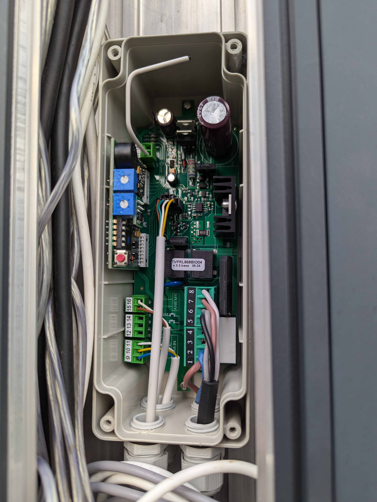
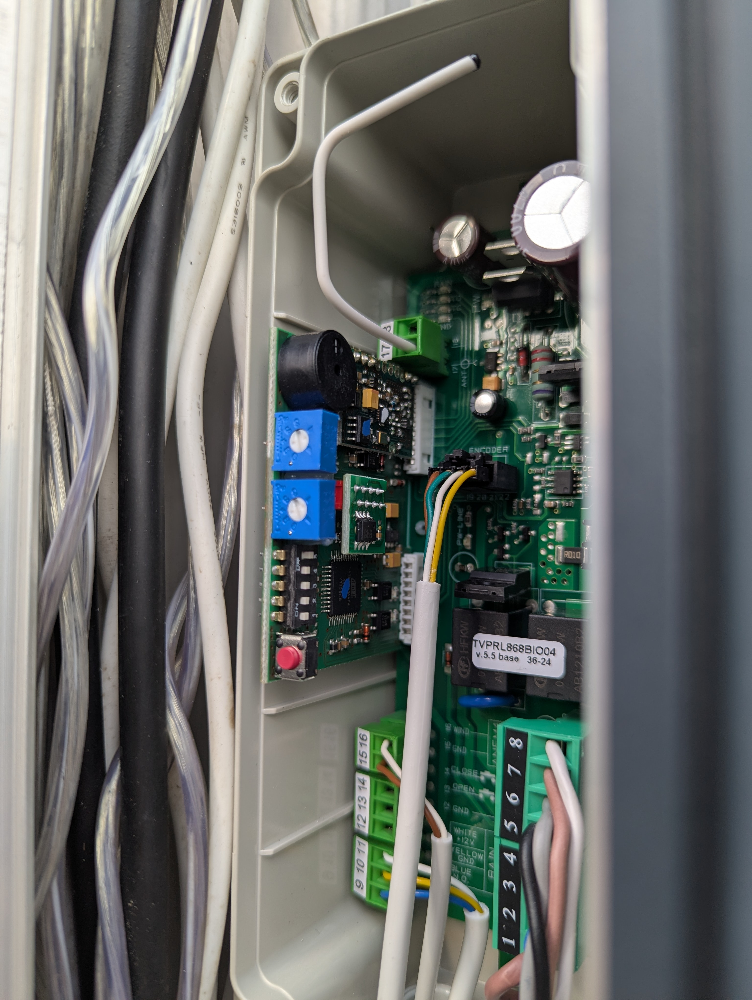
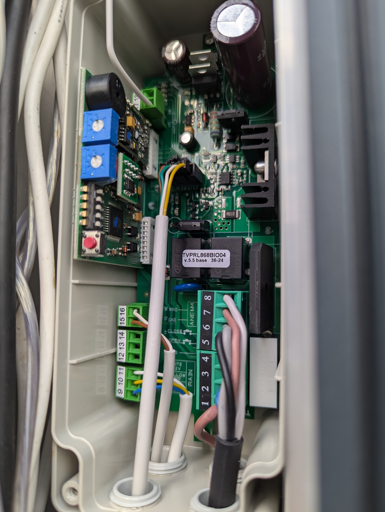
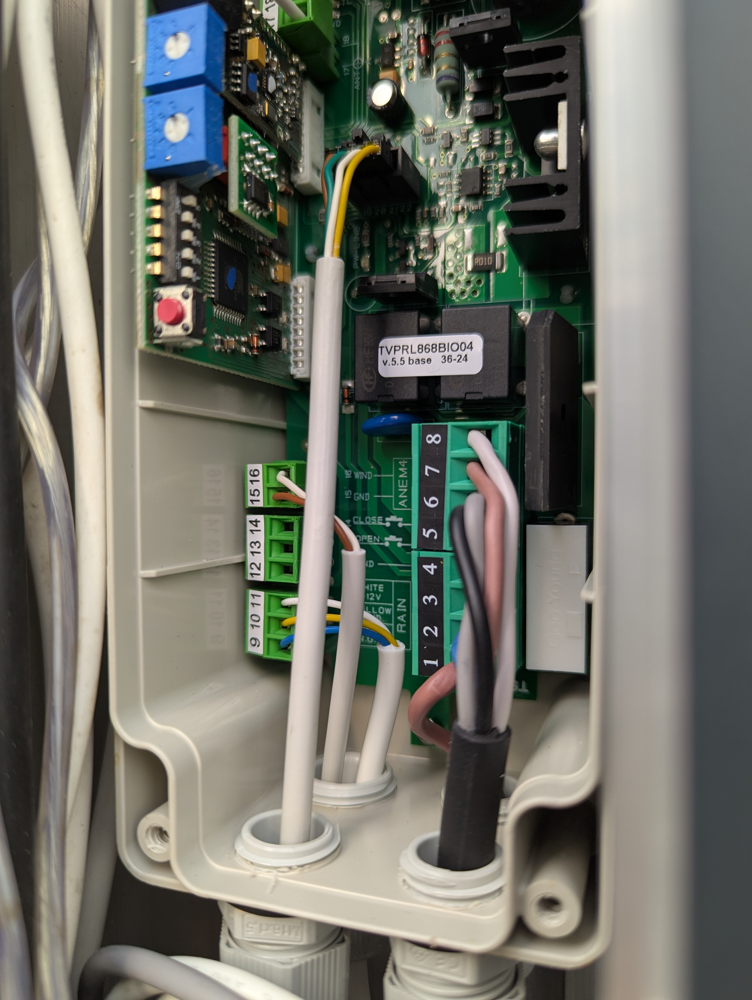
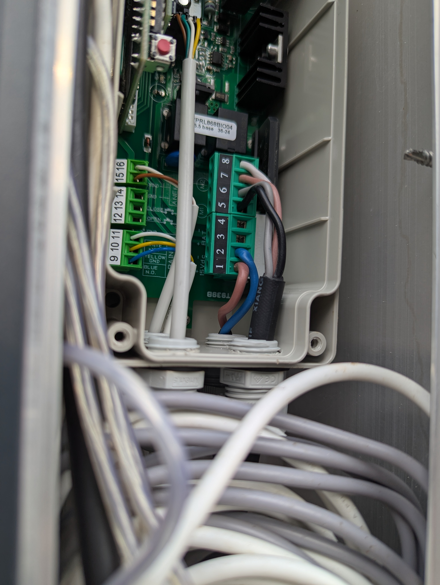
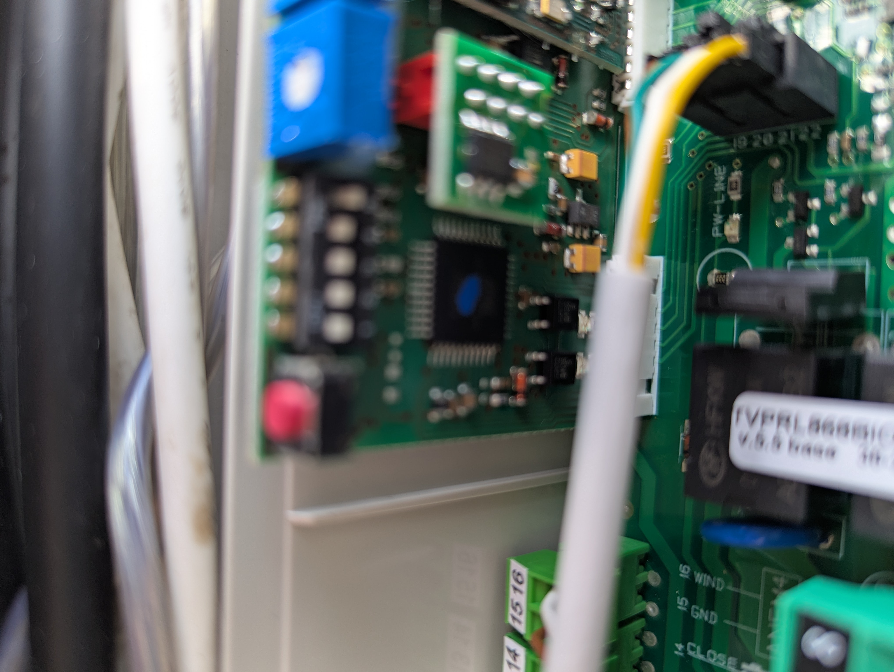
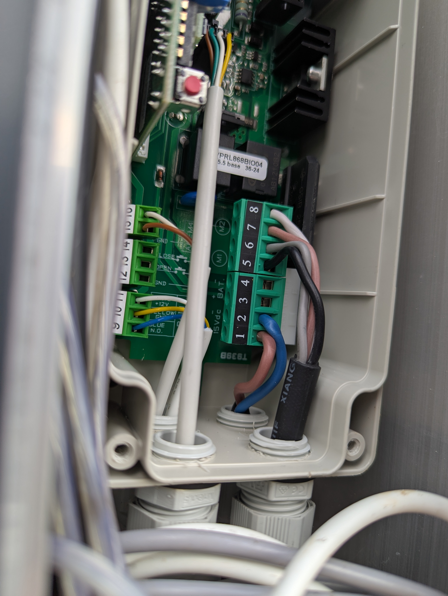

# Pergola Driver

This project contains the hardware and setup photos for the pergola driver.

## Images

  
  
  

  
  
  

  

## Notes

These images document the pergola driver assembly and installation views for reference and maintenance.

ZETA 868 ?
